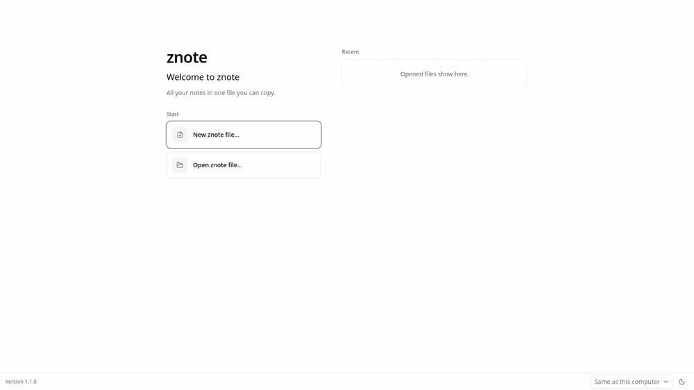

# znote
**znote** is a lightweight desktop editor for Typst, built with Tauri. Type on one side and watch your document render on the other. No compile step, no waiting.



Change how the app looks with a look (`.zth`) and add Typst page templates with an add-on (`.znx`), both from the Marketplace or imported from a file.

znote also has an assistant. Connect your own Claude subscription (it runs Claude Code), an OpenRouter key, or your own OpenAI-compatible server such as Ollama, and use the assistant to write new pages from a prompt, restructure sections, fix formatting, or edit in plain language. The assistant works directly on your `.typ` files, every change shows up live in the preview, and you review each change in the editor and keep or undo it.

More screenshots are in [`packaging/repo/demo/`](packaging/repo/demo/).

## Download

Get znote for Windows, macOS or Linux from the
[download page](https://zal-analytics.github.io/znote/), or pick a file from the
[latest release](https://github.com/ZAL-Analytics/znote/releases/latest):

- Windows: the installer (`.exe`)
- macOS: the disk image (`.dmg`)
- Linux: Debian and Ubuntu (`.deb`), Fedora (`.rpm`) or Arch Linux (`.pkg.tar.zst`)

**Features**
- Live Typst preview that updates as you type
- Pages in projects and notebooks, kept in one encrypted `.znote` file with your assistant chats
- Looks for the interface and Typst templates from the Marketplace
- Export to PDF, PowerPoint and Word
- Assistant panel, or a layout built around the assistant
- Names hidden from the assistant, and a private knowledge base it can search
- Native, fast and small, powered by Tauri

**Documentation**
- [The `.znote` format](docs/znote-file.md): the encrypted file that holds your pages and chats
- [The `.znx` format](docs/znx.md): how to build a Marketplace add-on with Typst templates
- [The `.zth` format](vendor/zsuite/docs/zth.md): how to build a look (colours, logo, interface font)
- [The `.znote-knowledge` format](docs/znote-knowledge.md): the encrypted file that remembers what is hidden and holds the knowledge base
- [SKOS glossaries](docs/skos-glossary.md): which terms to hide, for whoever builds a glossary
- [Privacy policy and detection rules](docs/privacy-policy.md): what a company that ships its own znote can lock, and how names, amounts and languages are detected

## What the assistant sees

With "Hide names" on (Settings > Privacy, or per chat), znote replaces text before it leaves
your computer with tokens such as `⟦CUSTOMER_3⟧`, and puts the real text back in replies and edits.
Only znote knows what a token stands for; it keeps that in your encrypted `.znote-knowledge` file.
Hiding runs in the Rust backend. When it cannot run (no knowledge file, a locked one, or a name
finder that is not downloaded) nothing is sent and the chat says why.

**Hidden:**
- every term in your glossary (customers, people, projects, products, ...), in every spelling it lists
- e-mail addresses, phone numbers, IBANs, card numbers, IP addresses and web addresses
- amounts of money, unless you switch that off
- with the optional name finder: names of people, organisations, products, projects and places
  that are not in the glossary. Each page and attached file has a level that sets which of these
  it hides. The name finder misses some names.
- this applies to the text of your pages, attached files, web pages the assistant reads, the
  chat history sent to the provider, the names of projects, notebooks and pages, the instructions
  znote gives the assistant, and the files Claude Code can read

**Not hidden:**
- the facts around a name: "⟦CUSTOMER_3⟧ pays ⟦AMOUNT_4⟧ per month for compressor maintenance"
  still says what kind of business it is. Only a model on your own computer avoids that.
- text a glossary term is split by, such as `*Acme* Corp`, or a term broken over two lines

Click the eye in the editor toolbar to see a page the way the assistant sees it, and to choose
what is hidden. "Show what this message would send" shows a message as it will leave your computer,
before it is sent. With hiding off, the assistant sees your pages as
they are. A company that ships its own znote can make hiding mandatory; see
[the privacy policy](docs/privacy-policy.md).

## Build from source

znote needs [pnpm](https://pnpm.io), Rust and the
[Tauri prerequisites](https://v2.tauri.app/start/prerequisites/) for your system. The interface
kit comes from the `vendor/zsuite` submodule, so clone with it:

```sh
git clone --recurse-submodules https://github.com/ZAL-Analytics/znote.git
cd znote
pnpm install
pnpm tauri dev
```

In a clone made without `--recurse-submodules`, run `git submodule update --init` first.

## Verifying a download

Every package on the releases page has two files next to it: a `.sha256`
checksum and a `.asc` OpenPGP signature by Arsalan Anwari (`arsalan-anwari`).
The checksum shows the file arrived intact, the signature that it was
published by the maintainer and nobody else.

```sh
# once: import the signing key, from github or from keys.openpgp.org
curl -sL https://github.com/arsalan-anwari.gpg | gpg --import
gpg --keyserver hkps://keys.openpgp.org --recv-keys 88A9AE5871B9A36EE3305977829EFCCDE81402E6

# for each download, next to its .asc and .sha256
sha256sum -c znote_1.0.0_amd64.deb.sha256
gpg --verify znote_1.0.0_amd64.deb.asc znote_1.0.0_amd64.deb
```

`gpg` must print `Good signature` and the primary key fingerprint
`88A9 AE58 71B9 A36E E330  5977 829E FCCD E814 02E6`. Any other fingerprint, or
a `BAD signature`, means the file is not the one that was published: do not install it.

Each package also carries a build provenance attestation, which shows it was
built by this repository's release workflow from the tagged source:

```sh
gh attestation verify znote_1.0.0_amd64.deb --repo ZAL-Analytics/znote
```
